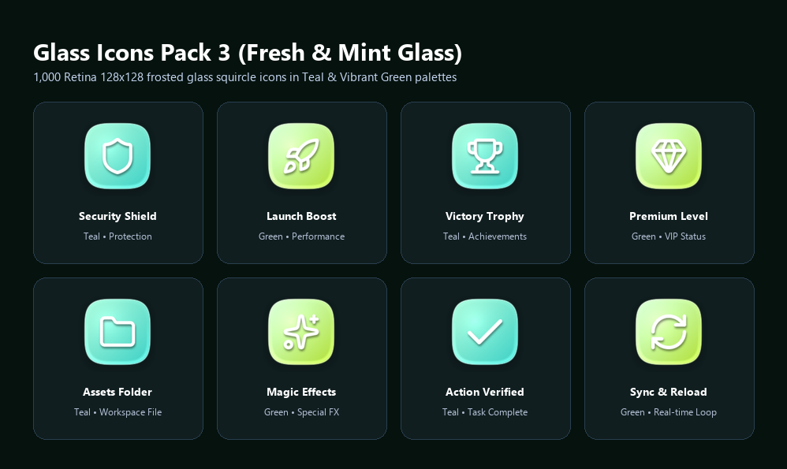
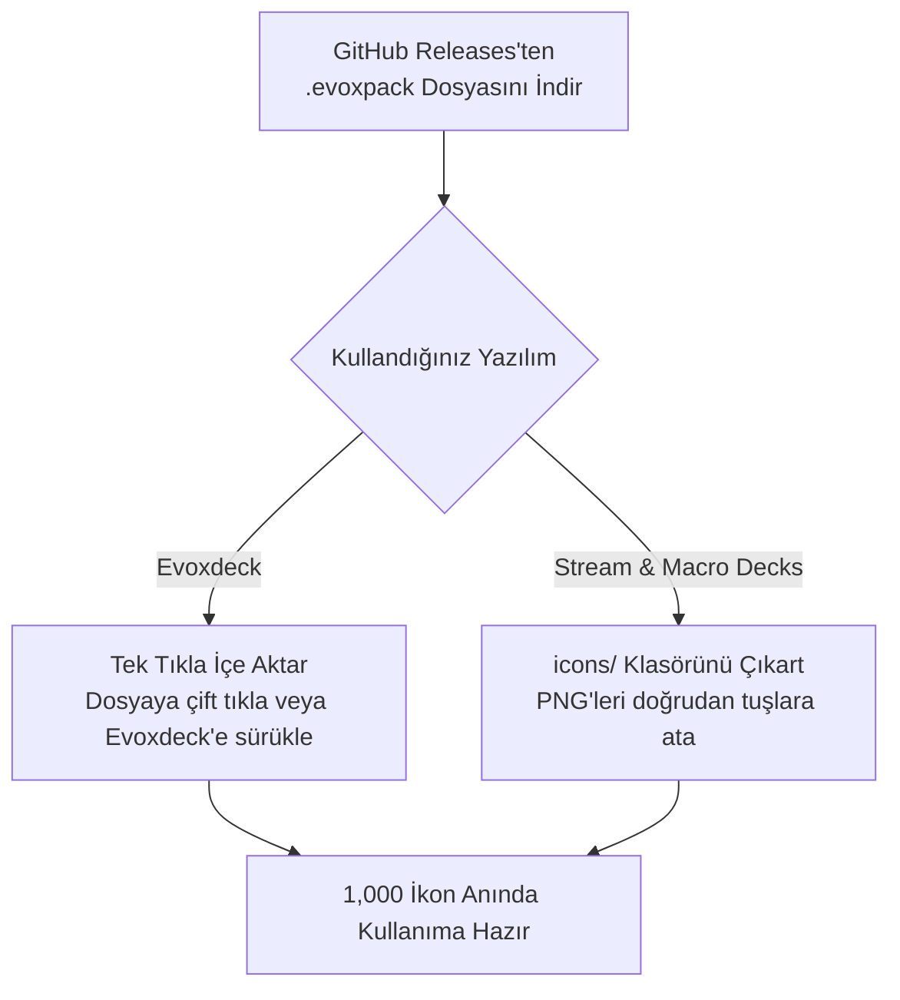

  
  <h1>Glass Icons Pack 3 (Fresh & Mint Glass)</h1>
  
<strong>Zengin Deniz Mavisi (Teal) ve Parlak Canlı Yeşil Cam temalarında 1.000 adet fiziksel buzlu cam Stream Deck & Evoxdeck ikon paketi.</strong>

  

    <strong>Dil:</strong> <a href="README.md"><strong>EN</strong></a> | <a href="README.tr.md"><strong>TR</strong></a>
    &nbsp;•&nbsp;
    <a href="https://github.com/Hfatih/glass-icons-pack-3/releases/latest">.evoxpack İndir</a> ·
    <a href="https://hfatih.github.io/glass-icons-pack-3/">Canlı Web Galerisi</a> ·
    <a href="#kurulum">Nasıl Kurulur?</a>
  

  

    
    
    
    
    
    
  

  

    
    
    
    
    
  

---

## Genel Bakış

**Glass Icons Pack 3 (Fresh & Mint Glass)**, **Stream & Macro Decks**, **Evoxdeck**, **Loupedeck** ve **Touch Portal** donanımları için tasarlanmış, yüksek kaliteli fiziksel buzlu cam ikon koleksiyonudur.

Her bir ikon Retina $128\times 128$ çözünürlükte, süperelips ($p=3.65, r=53$) squircle cam kiremit üzerinde, yumuşak ışık kırılmaları, iç pah ışıltısı ve derinlikli 3D kabartmalı beyaz sembollerle üretilmiştir.

### 🌐 Canlı Web Deneyimi & Galeri
Hiçbir dosya indirmeden 1,000 ikonun tamamını doğrudan tarayıcınızda arayabilir, filtreleyebilir ve 15 tuşlu sanal Stream Deck üzerinde deneyebilirsiniz:
👉 **[GitHub Pages Üzerinde Galeriyi Aç](https://hfatih.github.io/glass-icons-pack-3/)**

---

## Vitrin & Önizleme

| Stream Deck Canlı Tuş Dizilimi |
| :---: |
|  |
| *Buzlu cam zemin üzerinde saf beyaz minimalist vektörler ve 3D kabartma derinliği.* |

---

## Renk Paletleri

| Tema Adı | Kod | Sol-Üst RGB | Sağ-Alt RGB | Hex Gradyan |
| :--- | :--- | :--- | :--- | :--- |
| **Deniz Mavisi (Teal)** | `teal` | `rgb(158, 240, 209)` | `rgb(58, 208, 198)` | `#9ef0d1` ➔ `#3ad0c6` |
| **Canlı Yeşil (Green)** | `green` | `rgb(206, 255, 206)` | `rgb(176, 222, 52)` | `#ceffce` ➔ `#b0de34` |

---

## Kategoriler (500 Sembol × 2 Tema)

1. **🎙️ Ses & Mikrofon Kontrolleri:** Mikrofon, Kulaklık, Ses Seviyeleri (0-1-2-Mute), Dalga Boyu Grafikleri, Ekolayzer, Mixer.
2. **🎵 Medya & Müzik:** Oynat, Duraklat, İleri, Geri, Karıştır, Tekrarla, Plak, Radyo, Podcast, Kamera, Video, 4K, HD.
3. **⭐ Yayıncı Rozetleri:** REC, LIVE, Game Audio, Mic On, Mute, AFK, GG, VIP, MOD, Clutch, Sub, Chat.
4. **🎮 Oyun & Espor:** Minecraft, Valorant, League of Legends, Steam, OBS Studio, Discord, Twitch, Gamepad, Joystick.
5. **📱 Sosyal Medya & Platformlar:** YouTube, Twitch, Spotify, TikTok, Twitter/X, Instagram, Kick, Reddit, Telegram, WhatsApp.
6. **⚙️ Sistem & Donanım:** CPU, GPU, RAM Bellek, Monitör, Laptop, Mouse, Klavye, WiFi, Bluetooth, Güç, Ayarlar.

---

## Kurulum

### 1. Evoxdeck (Önerilen)
1. [Releases](https://github.com/Hfatih/glass-icons-pack-3/releases/latest) sayfasından `Glass Icons Pack 3.evoxpack` dosyasını indirin.
2. Dosyaya çift tıklayın veya **Evoxdeck** ➔ **Ayarlar** ➔ **İkon Paketleri** ➔ **Paket İçe Aktar** yolunu izleyin.
3. 1,000 ikon anında arama ve etiketleriyle kütüphanenize eklenir.

### 2. Stream & Macro Decks
1. Depodaki `icons/` klasörünü açın.
2. Stream & Macro Decks yazılımında istediğiniz PNG dosyasını tuş yuvasına sürükleyip bırakın.

---

## Lisans

**MIT Lisansı** altında sunulmaktadır. Kişisel ve ticari yayınlarda serbestçe kullanılabilir.
💖 **[Fatih Han](https://github.com/Hfatih)** tarafından sevgiyle hazırlandı.
